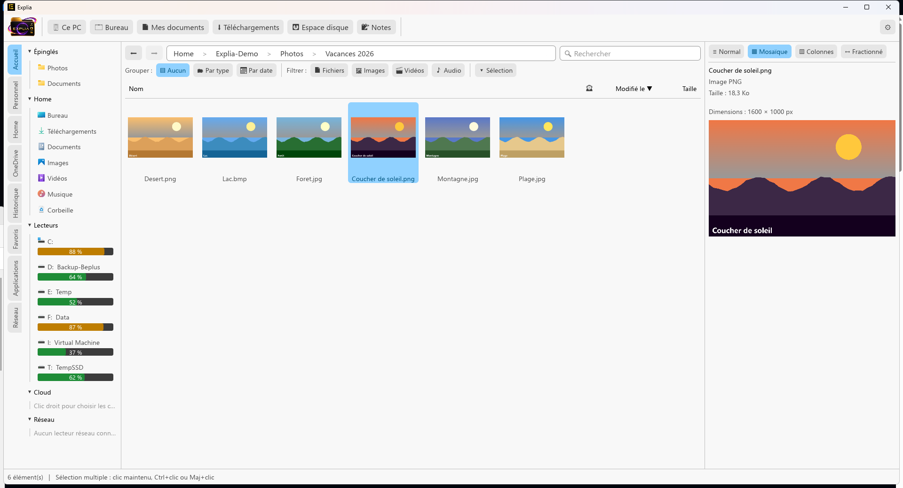
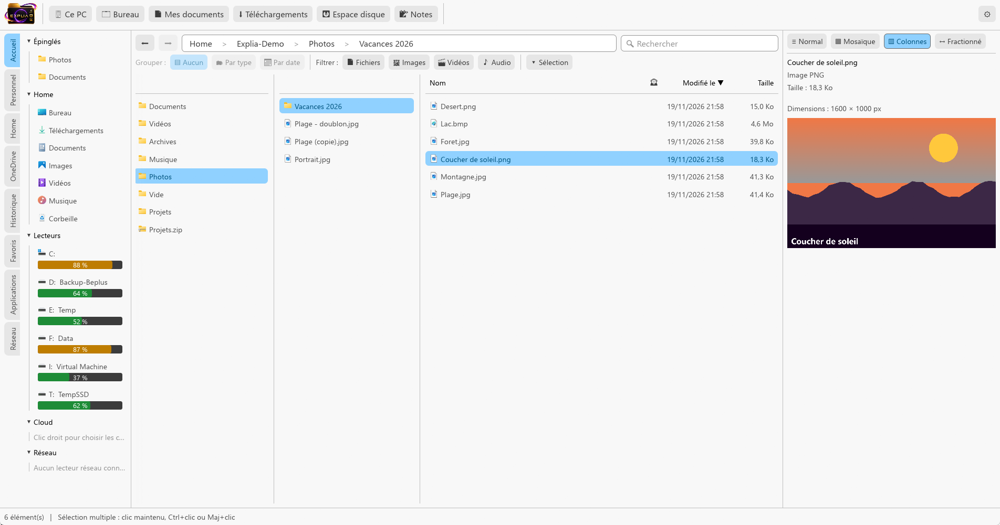
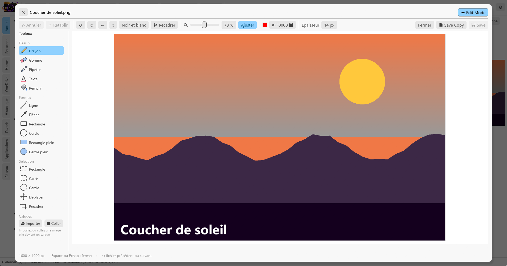
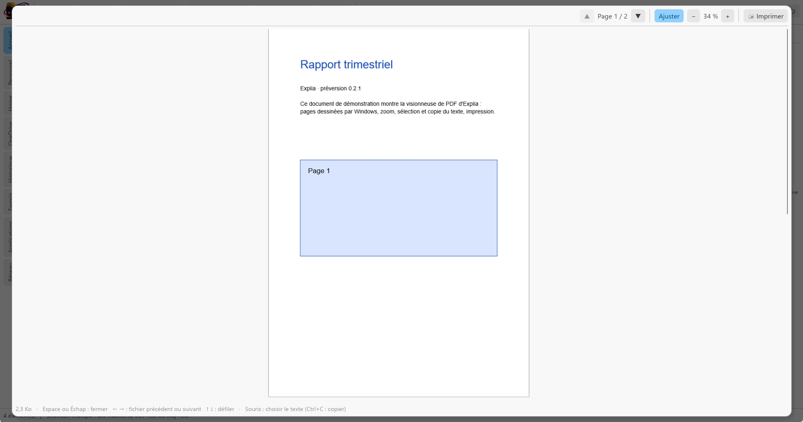
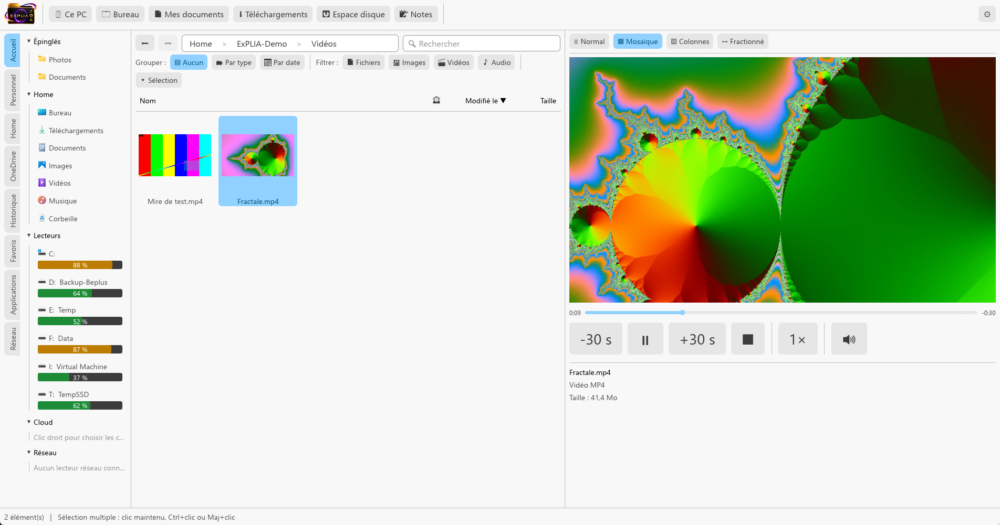
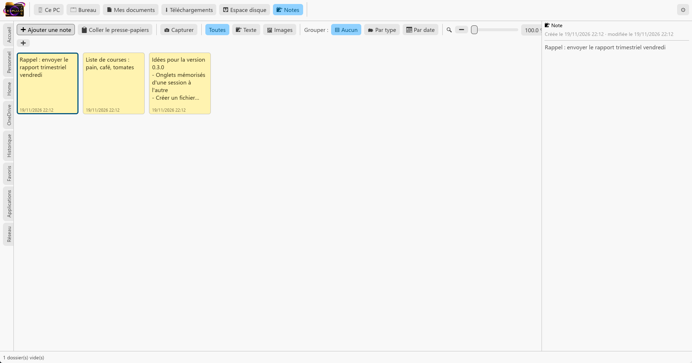
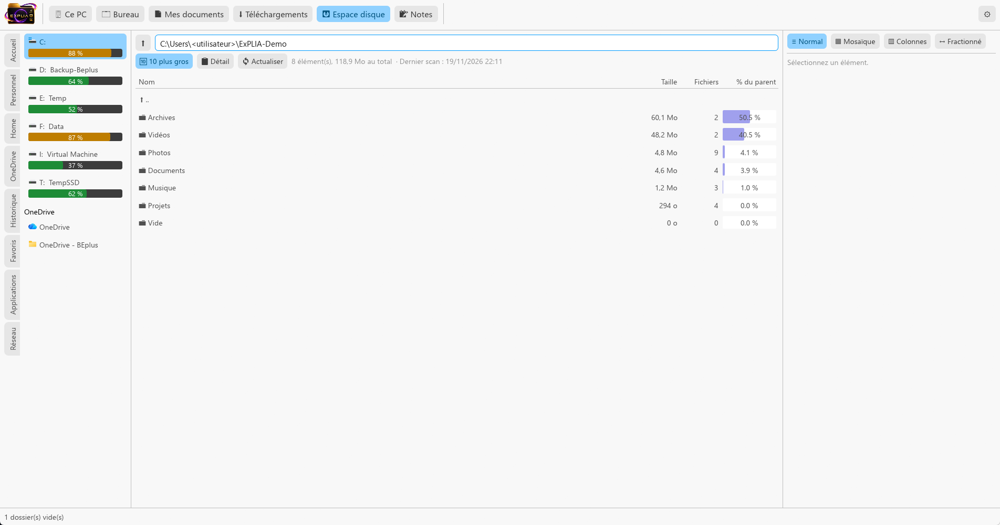

# Explia

**L'explorateur de fichiers nouvelle génération pour Windows 10 et 11.**

[**⬇ Télécharger Explia**](https://github.com/innov-lia/Explia/releases/latest) · [Prise en main](#prise-en-main) · [Raccourcis](#raccourcis-clavier) · [English](#in-english)

Explia réunit dans une seule fenêtre tout ce qu'on va chercher d'habitude dans plusieurs outils : navigation rapide, aperçus de vos images, PDF et documents, retouche d'image, lecteur vidéo et musique, bloc-notes, analyse de l'espace disque et chasse aux doublons. Prudent avec vos fichiers : **rien n'est jamais écrasé**, et la suppression passe toujours par la **corbeille**, après confirmation.

## Installation

1. Ouvrez la page [**Versions**](https://github.com/innov-lia/Explia/releases/latest) et téléchargez `explia-…-windows-x64.zip`.
2. Décompressez-le et lancez **`explia.exe`**. Il n'y a rien à installer.

- Prérequis : **Windows 10 ou 11, 64 bits**.
- Windows peut afficher un avertissement SmartScreen : cliquez sur « Informations complémentaires » puis « Exécuter quand même ».
- Facultatif : installez [VLC](https://www.videolan.org) (version 3, 64 bits) pour lire les vidéos et la musique directement dans Explia. Sans VLC, elles s'ouvrent dans le lecteur de Windows.
- L'empreinte SHA-256 du zip est donnée sur la page de la version.

## Prise en main

La fenêtre a trois volets : **à gauche** la navigation, **au centre** le contenu du dossier, **à droite** les détails et l'aperçu de l'élément choisi.

- **Se déplacer** : double-clic ou **Entrée** pour ouvrir un dossier, **Retour arrière** pour remonter, ou cliquez dans le chemin en haut (vous pouvez aussi y taper une adresse, puis Entrée).
- **Volet de gauche** : onglets *Accueil* (vos dossiers, vos disques et leur remplissage), *Historique*, *Favoris*, *Applications*, *OneDrive*, *Réseau*. Clic droit sur un dossier > « Épingler à l'accueil » ou « Ajouter aux favoris ».
- **Affichages** (en haut à droite) : **Normal** (liste), **Mosaïque** (miniatures des photos et vidéos), **Colonnes**, **Fractionné** (deux dossiers côte à côte pour copier de l'un à l'autre).
- **Trier et ranger** : cliquez sur un titre de colonne pour trier ; *Grouper* par type ou par date ; *Filtrer* les images, vidéos, sons.
- **Rechercher** : **Ctrl+F**, tapez un nom ou un motif (`*.pdf`, `photo_??.jpg`) ; la recherche fouille aussi les sous-dossiers.
- **Aperçu rapide** : sélectionnez un fichier et appuyez sur **Espace** (images, textes, PDF, documents Office). **Échap** ferme, **← →** passent au fichier suivant.
- **Clic droit** sur un élément : copier, couper, coller, renommer, dupliquer, compresser en ZIP, ouvrir avec…, propriétés, et le menu habituel de Windows.

### Ce que vous pouvez faire

- **Retoucher une image** : Espace sur une image, puis **Edit Mode** : crayon, formes, flèches, texte, recadrage, rotation, calques. **Save** enregistre, **Save Copy** crée une copie à côté.
- **Modifier un texte** : Espace sur un fichier texte, il s'ouvre prêt à être modifié (rechercher, remplacer, imprimer, **Ctrl+S** pour enregistrer).
- **Lire un PDF** : Espace sur un PDF ; zoom, pages, copie du texte, impression.
- **Regarder une vidéo, écouter de la musique** : double-clic ; la vidéo continue pendant que vous naviguez. Les sons se rangent dans une **playlist** (volet de droite).
- **Notes** (bouton en haut) : notes de texte ou d'image, collage du presse-papiers, capture d'écran ; elles sont **chiffrées** sur votre ordinateur.
- **Espace disque** (bouton en haut) : ce qui prend de la place sur un disque ou un dossier.
- **Faire le ménage** (menu *Sélection*) : **doublons**, **gros fichiers**, **dossiers vides**, puis envoi à la corbeille.
- **ZIP** : clic droit « Compresser en ZIP » ; double-clic sur un ZIP pour l'extraire dans un nouveau dossier.
- **Glisser-déposer** avec l'Explorateur et le Bureau.
- **Réglages** (roue en haut à droite) : langue (français, anglais, espagnol, allemand, italien, portugais), affichage, colonnes, et **composition de vos menus du clic droit** par glisser-déposer.

| | |
| --- | --- |
|  |  |
|  |  |

## Raccourcis clavier

| Touche | Action |
| --- | --- |
| **↑ ↓** / **Entrée** | Choisir / ouvrir |
| **Retour arrière** ou **←** | Dossier parent |
| **Alt+← / Alt+→** | Dossier précédent / suivant |
| **Espace** | Aperçu rapide (ou lecture / pause) |
| **Ctrl+F** | Rechercher |
| **F2** | Renommer |
| **Suppr** puis **Entrée** | Envoyer à la corbeille |
| **Ctrl+C / Ctrl+X / Ctrl+V** | Copier / couper / coller (sans jamais écraser) |
| **Ctrl+Maj+N** | Nouveau dossier |
| **Ctrl+T / Ctrl+W** | Nouvel onglet / fermer l'onglet |
| **Alt+Entrée** | Propriétés |
| **Ctrl+clic, Maj+clic** | Sélection multiple |

## Vos données

- Aucune publicité, aucune télémétrie, aucun compte : Explia ne se connecte jamais à Internet.
- Vos réglages sont dans `%APPDATA%\ExPLIA\settings.txt` ; vos notes, chiffrées, dans `%APPDATA%\ExPLIA\notes`.
- Explia ne touche à vos fichiers que lorsque vous le demandez, sans jamais écraser un fichier existant ; la suppression va toujours à la corbeille.

## Limites connues

- Préversion, testée sur Windows 11 ; l'exécutable n'est pas signé.
- Archives : ZIP uniquement.
- Fenêtre « Voulez-vous sauvegarder ? » des éditeurs : les boutons peuvent ne pas répondre ; enregistrez avec **Save** ou **Ctrl+S** avant de fermer.

## In English

**Explia is a modern file explorer for Windows 10/11 (64-bit)**, shipped as a single portable `explia.exe`: download the zip from [Releases](https://github.com/innov-lia/Explia/releases/latest), unzip and run. Three panes (navigation, folder content, details), list / thumbnails / columns / split views, quick look with **Space** (images, text, PDF, Office documents), image editing, video and music playback (with VLC installed), encrypted notes, disk usage, duplicate and large-file finder, ZIP, drag and drop, six interface languages. No telemetry, no network access; files are never overwritten and deletions always go to the Recycle Bin.
